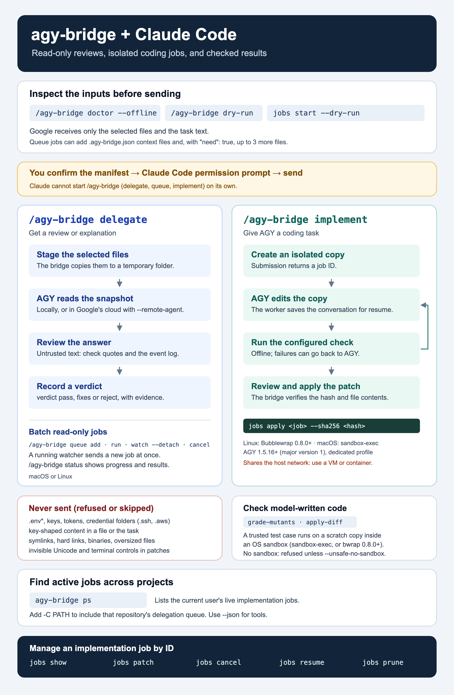

# agy-bridge skill

This folder is the whole `agy-bridge` agent skill: the instructions in [SKILL.md](SKILL.md), the bridge script in
`scripts/` and its documentation in `references/`. The script uses only the Python 3.9+ standard library.

| Path | Contents |
|---|---|
| [`SKILL.md`](SKILL.md) | The actions (`delegate`, `dry-run`, `queue`, `implement`, `jobs`, `status`, `doctor`) and their confirmation rules |
| `scripts/agy-bridge` | The launcher; it puts its own `scripts/` folder on `sys.path` and runs the `agy_bridge` package |
| `scripts/agy_bridge/` | The bridge: staging, denylist, content scan, agy runner (local, and remote agents through agy's terminal UI), queue, implementation jobs, grading |
| [`references/`](references/CLI.md) | [CLI](references/CLI.md), [queue](references/QUEUE.md), [implementation](references/IMPLEMENT.md), [grading](references/GRADING.md), [threat model](references/THREAT_MODEL.md), [compatibility](references/COMPAT.md), [manual tests](references/MANUAL_TEST.md) |
| `agents/openai.yaml` | Codex metadata: `allow_implicit_invocation: false`, so only `$agy-bridge` starts the skill |
| `assets/` | [`job.json`](assets/job.json) (a queue job), [`agy-bridge.json`](assets/agy-bridge.json) (copy to `<repo>/.agy-bridge.json`) and the workflow infographic |

Invoke it as `/agy-bridge delegate <task, files>` in Claude Code (`/agy:agy-bridge ...` when installed as the
plugin) or `$agy-bridge delegate ...` in Codex. You can also run the script directly from any folder:

```sh
.claude/skills/agy-bridge/scripts/agy-bridge --version
.claude/skills/agy-bridge/scripts/agy-bridge doctor --offline
.claude/skills/agy-bridge/scripts/agy-bridge dry-run -C "$PWD" -f src/a.py -- "Explain what a.py does"
```



Installation, requirements and the full overview: the
[project README](https://github.com/dominno/claude-agy-bridge#readme). MIT licensed, see [LICENSE](LICENSE).
