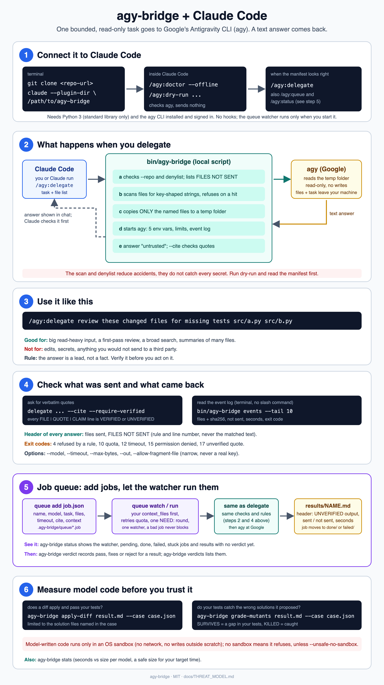

# agy-bridge

A small Claude Code plugin that hands one bounded, read-only task to Google's Antigravity CLI (`agy`) and returns the
text answer. Use it to offload big, read-heavy work to another model while keeping what leaves your machine small,
explicit and auditable. Safety rules are enforced by a local script (Python standard library only), not by a prompt.

Not affiliated with or endorsed by Google or Anthropic.

**Status: v0.1, early.** The test suite uses a fake `agy`. The bridge has been run once against the real `agy` 1.4.3
(2026-10-20, fake files only): doctor, dry-run and delegate work, and writes, commands, reads outside the folder and
network use were not possible headless without a permission. That is one version on one machine, not a guarantee; see
[`docs/COMPAT.md`](docs/COMPAT.md) for what was measured and what stays unverified. A basic delegation also worked on
1.4.12. The plugin has been loaded in real Claude Code sessions. The suite runs on macOS and Linux (`bwrap` backend);
the `unshare` fallback has not been exercised on a real Linux host.



## When to use it

**Good for:** a first-pass review of many files, a broad search, summaries of large read-heavy input.

**Not for:** edits, quick questions, secrets, or anything you would not send to a third party. The answer is a lead, not
a fact: verify it before you act on it.

## Requirements

- macOS or Linux. Windows is untested.
- Python 3.9 or newer. No packages are needed to run it.
- [Claude Code](https://claude.com/claude-code), for the slash commands. The script also works on its own.
- The Antigravity CLI, installed and signed in: follow [Google's instructions](https://antigravity.google/docs/cli-using),
  then check with `agy --version` and `agy models`. Major version 1 is supported; other majors are refused.
- Only for `grade-mutants` and `apply-diff`: `sandbox-exec` (macOS) or `bwrap`/`unshare` (Linux).

## Quick start

Install the plugin in Claude Code:

```text
/plugin marketplace add dominno/claude-agy-bridge
/plugin install agy@agy-bridge
```

Or try it for one session only, without installing anything:

```sh
git clone https://github.com/dominno/claude-agy-bridge.git
claude --plugin-dir ./claude-agy-bridge
```

Then, inside a Git repository of your own:

```text
/agy:doctor --offline
/agy:dry-run src/a.py src/b.py -- review these files for missing tests
/agy:delegate review these files for missing tests, files: src/a.py src/b.py
```

`doctor` checks the setup. `dry-run` shows exactly which files would be sent and sends nothing. `delegate` runs the task
and shows the answer, labelled as untrusted. Add `.agy-bridge/` to the ignore file of every repository you use it in.

The same without Claude Code:

```sh
bin/agy-bridge dry-run  --repo "$PWD" --file src/a.py -- "Explain what a.py does"
bin/agy-bridge delegate --repo "$PWD" --file src/a.py --timeout 5m -- "Explain what a.py does"
```

| Slash command | What it does |
|---|---|
| `/agy:doctor` | Read-only health check |
| `/agy:dry-run` | Shows what a delegation would send; sends nothing |
| `/agy:delegate` | Hands one task to `agy` and returns the answer |
| `/agy:queue` | Adds a job to the serial queue or drains it |
| `/agy:status` | Shows the watcher, queue counts and results awaiting a verdict |

## Data flow warning

The staged files and your task text are sent to Google by `agy` and processed by a model there. The scan and the
denylist reduce accidents; they do not detect every secret (encoded or split secrets pass) and they cannot judge
whether content is confidential. Run `dry-run` first and read the manifest. Do not delegate anything you would not
send to a third party.

## What it does

- Copies only the files you name (or glob) into a throw-away staging folder, with a short `TASK.md`.
- Runs `agy` there, in a terminal pair, with a time limit and an output cap.
- Returns the answer as text, labelled as untrusted.

## What it never does

- Pass `--dangerously-skip-permissions`, `--yolo` or any permission-widening flag.
- Pass your environment on: the process `agy` starts with has exactly `HOME`, `PATH` (absolute entries only),
  `LANG`, `TERM`, `TMPDIR`. This says nothing about what `agy` itself can read under that `HOME`.
- Stage a file whose path, **or the path of the `--repo` folder above it**, has a denylisted name (`.env`, `.git`,
  `.codex`, `.claude`, `.ssh`, `gcloud`, `*credentials*`, ...); symlinks, hard links, devices, pipes, binary or
  oversized files; or any file with a key-shaped string (the report names the file, count and first hit line, never the text).
- Accept a `--repo` that is `/`, your home folder or anything above it (compared by device and inode, so letter case,
  symlinks and `..` do not matter), a system folder such as `/etc`, a denylisted folder, or a folder inside a hidden
  folder of your home (such as `~/.config/foo`). By default `--repo` must hold a real `.git` directory (or a `.git` file
  naming a real directory inside it); `--allow-non-git-root` relaxes only that.
- Run `agy` inside your repository or keep file contents in its metadata logs. Answers live only in temporary storage
  or the explicit repository workflow directory; configured queue result folders must remain inside the repo.
- Install hooks, start an unsolicited watcher, install subagents or skills; touch `~/.claude` or `~/.gemini`; or make a network call
  itself.

## What the slash commands can and cannot do

`allowed-tools: Bash(${CLAUDE_PLUGIN_ROOT}/bin/agy-bridge:*)` only pre-approves running the script with any arguments,
so Claude Code does not ask each time. It is not a restriction. The limits are enforced in the script (the `--repo`
checks, `--out` locations, denylist and content scan).

What `dry-run` does: it reads and checks the files exactly like `delegate`, **writes them to a temporary folder (mode
0700, removed before it exits)**, prints the manifest and the `agy` command line, and runs `agy --version` with the
five-name environment in an empty folder. That is the only program a dry run starts; delegation never runs git. No file contents and no task text go to `agy`.

To have a diff reviewed, pass the changed source files with `--file`.

## Job queue

A serial queue, for several tasks in a row. Nothing runs until you start it. Save a job as `job.json`:

```json
{
  "name": "review-parser-01",
  "task": "Review the parser against its tests.",
  "files": ["src/parser.py", "tests/test_parser.py"],
  "timeout": "5m"
}
```

```sh
bin/agy-bridge queue add job.json --repo /path/to/repo
bin/agy-bridge queue run --repo /path/to/repo     # drain once; `queue watch` keeps polling until interrupted
bin/agy-bridge status --repo /path/to/repo
```

Results land in `.agy-bridge/results/`. Format, configuration and exits: [`docs/QUEUE.md`](docs/QUEUE.md).

## Checking results

Every result is **unverified model output** until a reader checks its claims:

```sh
bin/agy-bridge verdict --repo /path/to/repo --job review-parser-01 --verdict pass --by reader --evidence "Checked sources and tests"
bin/agy-bridge verdicts --repo /path/to/repo --tail 10
bin/agy-bridge grade-mutants result.md --repo /path/to/repo --case case.json
bin/agy-bridge apply-diff result.md --repo /path/to/repo --case case.json
bin/agy-bridge stats --repo /path/to/repo --target 180
```

`grade-mutants` and `apply-diff` **execute model-written code**, only in a scratch copy inside an OS sandbox. They never
change your working tree. If the sandbox is unavailable they refuse to run; `--unsafe-no-sandbox` explicitly removes
that protection and runs the code with your privileges and network access. See [`docs/GRADING.md`](docs/GRADING.md).

## Documentation

| File | Contents |
|---|---|
| [`docs/CLI.md`](docs/CLI.md) | All options, exit codes, repo config, input notices, `--cite` and the event journal |
| [`docs/QUEUE.md`](docs/QUEUE.md) | Job format, folders, locking, retries |
| [`docs/GRADING.md`](docs/GRADING.md) | Trusted case format, mutants, diffs, the sandbox, timing stats |
| [`docs/THREAT_MODEL.md`](docs/THREAT_MODEL.md) | Rules R1 to R9, the tests that prove them, residual risks |
| [`docs/COMPAT.md`](docs/COMPAT.md) | What is measured and what is unverified about `agy` |
| [`docs/MANUAL_TEST.md`](docs/MANUAL_TEST.md) | How to verify the bridge against a new `agy` version |
| [`SECURITY.md`](SECURITY.md) | Known limits and how to report a bypass |
| [`CONTRIBUTING.md`](CONTRIBUTING.md) | Development setup and project rules |

## Credit

The idea of a version-keyed argument builder, distinct exit codes and a wall-clock guard was inspired by
`yuting0624/antigravity-for-claude-code` (MIT). No code was copied from it.

## License

MIT, see [`LICENSE`](LICENSE).
